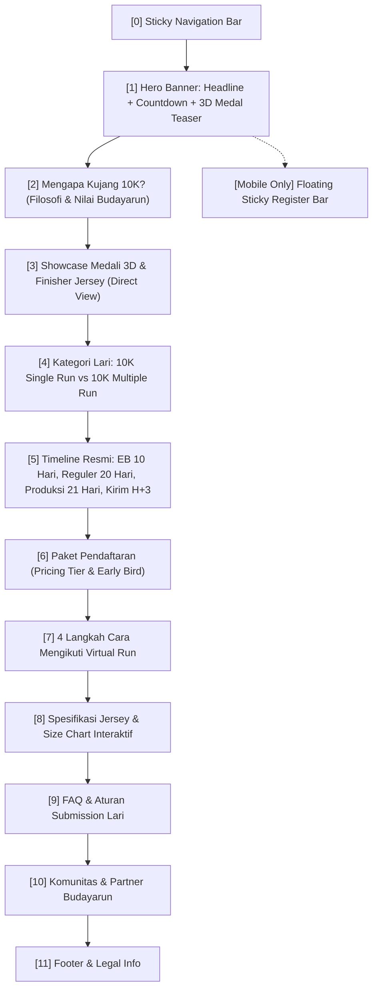

# DESIGN PLAN & UI/UX SPECIFICATION
## Landing Page Event Virtual Run: "Kujang 10K" by Budayarun

* **Project**: Landing Page Design System & Wireframe Architecture
* **Theme**: *Heritage Meets High-Performance Athletics (Neo-Sunda Sporty)*
* **Target Platforms**: Mobile Web (Primary, 75%+ traffic) & Desktop Web (25%)
* **Document Version**: v1.0.0

---

## 1. Creative Direction & Visual Philosophy

### 1.1 Tema Desain: "Vibrant Pasundan Cyber Athletics"
Berdasarkan visual resmi dari poster dan jersey event, konsep visual mengusung kombinasi **energi kinetik lari modern** (speedlines, pencahayaan neon cyan, electric royal blue, volt lime, dan hot pink) yang dipadukan dengan **kemewahan mahakarya pusaka Jawa Barat** (Medali 3D Twin Kujang dengan aksen emas & perak, serta relief Gedung Sate Bandung).

---

## 2. Design Tokens & Official Color Palette

| Token Name | Hex Code | Role & Usage |
| :--- | :--- | :--- |
| **Cosmic Deep Navy** | `#070914` / `#0C1024` | Background utama dengan aksen speedlines radial |
| **Card Navy Surface** | `#131836` | Background kartu, container komponen, dan modal |
| **Electric Royal Blue** | `#1B23D8` / `#2962FF` | Warna primer identitas Budayarun & dasar Jersey Pop-Art |
| **Neon Volt Lime** | `#D9FF00` | Aksen warna Finisher Jersey, countdown badge, dan highlight |
| **Neon Pink / Magenta** | `#FF1E8A` | Aksen tombol pendaftaran, speedlines, dan tali lanyard |
| **Neon Cyan / Turquoise** | `#00E5FF` | Garis glow, border kartu interaktif, teks sorotan |
| **Dual-Tone Gold & Silver** | `#F5B014` / `#E2E8F0` | Warna medali Twin Kujang & relief Gedung Sate |

---

## 3. Official Rewards & Race Pack Specifications

1. **Official Finisher Medal**:
   - Model: **Twin Kujang (Kujang Kembar Bersayap) & Gedung Sate**
   - Finishing: Dual-Tone Gold Plating & Chrome Silver
   - Lanyard Ribbon: Full-color woven satin dengan ornamen pop-art warna-warni Pasundan bertuliskan `10K KUJANG VIRTUAL RUN by budayarun`.
2. **Dua Pilihan Jersey**:
   - **Varian 1: Jersey Royal Blue (Pop-Art Budaya)**: Warna biru elektrik dipadukan grafis siluet pelari tradisional, bilah Kujang, dan flora Sunda warna volt lime & magenta.
   - **Varian 2: Finisher Jersey (Volt Lime to Emerald)**: Warna hijau stabilo gradasi dengan garis belakang vertikal bertuliskan "FINISHER".

> **Accessibility Note**: Kontras antara teks Pure White / Bright Gold dengan Obsidian Black memenuhi standar **WCAG 2.1 Level AAA** ($\ge 7:1$).

### 2.2 Tipografi (Typography Hierarchy)

* **Display / Headline Font**: `Oswald` atau `Bebas Neue` / `Space Grotesk`
  * *Karakter*: Condensed, bold, sporty, berenergi tinggi, sangat kuat untuk angka dan kalimat ajakan.
* **Body & UI Font**: `Plus Jakarta Sans` atau `Inter`
  * *Karakter*: Sangat bersih, modern, mendukung karakter lokal dan mudah dibaca pada layar kecil (mobile).

#### Skala Tipografi (Desktop & Mobile):
* **Hero Display H1**: Desktop $64\text{px}$ / Mobile $38\text{px}$ (ExtraBold, All Caps, Line Height $1.1$)
* **Section Title H2**: Desktop $40\text{px}$ / Mobile $28\text{px}$ (Bold, Line Height $1.2$)
* **Card Title H3**: Desktop $24\text{px}$ / Mobile $20\text{px}$ (SemiBold)
* **Body Regular**: $16\text{px}$ (Regular, Line Height $1.6$)
* **Body Small / Captions**: $14\text{px} / 12\text{px}$ (Medium, Slate Gray)
* **Stats / Countdown Numbers**: $36\text{px} - 48\text{px}$ (Bold Monospace / Tabular numbers)

---

## 3. Wireframe & Section-by-Section Architecture

---

### Detail Komponen per Seksi:

### Seksi 0: Sticky Navigation Bar
* **Kiri**: Logo Budayarun & Sub-logo Kujang 10K Virtual Run.
* **Tengah (Desktop)**: Menu navigasi jump-links: *Filosofi, Hadiah & Jersey, Kategori, Harga, FAQ*.
* **Kanan**:
  * Badge Status: *"Early Bird Aktif - Slot Terbatas"*
  * Tombol CTA: *"Daftar Sekarang"* (Pill button warna Emas Kujang dengan efek hover glow).

---

### Seksi 1: Hero Banner (First Fold / The Hook)
* **Layout**:
  * **Desktop**: 2 Kolom (Kiri: Teks & Countdown, Kanan: 3D Render Medali Kujang berputar perlahan / interaktif dengan efek partikel emas halus).
  * **Mobile**: 1 Kolom berurutan (Badge Event $\rightarrow$ Headline Kuat $\rightarrow$ Visual Hero Medali $\rightarrow$ Countdown Timer $\rightarrow$ Primary CTA).
* **Konten Teks**:
  * *Top Badge*: `[VIRTUAL RUN 2027 • TEMA JAWA BARAT]`
  * *Headline*: **"TAKLUKKAN 10 KILOMETER. MILIKI PUSAKA KSATRIA PASUNDAN."**
  * *Subheadline*: Berlari dari mana saja, kapan saja. Buktikan ketangguhanmu dan raih medali 3D Kujang eksklusif persembahan Budayarun.
* **Countdown Timer Widget**:
  * 4 Blok Kotak: `[ HARI ]` : `[ JAM ]` : `[ MENIT ]` : `[ DETIK ]` menuju penutupan harga Early Bird.
* **CTA Group**:
  * Tombol 1 (Primary): *"Ambil Slot Ksatria"* (Direct scroll ke Paket Pendaftaran).
  * Tombol 2 (Secondary Outline): *"Lihat Detail Medali"* (Icon play video 360 preview).
* **Social Proof Counter**:
  * Avatar tumpuk peserta + Teks: *"2.450+ Pelari telah mengamankan nomor dada mereka"*.

---

### Seksi 2: Filosofi Kujang & Nilai Budayarun
* **Headline**: *"Bukan Sekadar Lari, Ini Penghormatan Pada Warisan Leluhur"*
* **3 Kartu Pilar Filosofis**:
  1. **Kukuh Pengkuh (Keteguhan Tekad)**: Menguji konsistensi setiap kilometer yang kamu tempuh.
  2. **Silih Asah, Silih Asih, Silih Asuh**: Semangat kebersamaan komunitas pelari Nusantara.
  3. **Pusaka Marwah**: Medali Kujang bukan sekadar cinderamata, melainkan simbol marwah perjuanganmu menuntaskan target.

---

### Seksi 3: Finisher Rewards Showcase (The Core Desire Driver)
* **Headline**: *"Simbol Kemenangan Ksatria: Medali Twin Kujang 3D & Dua Pilihan Jersey"*
* **Tata Letak**: **Full Direct Showcase (Tanpa Tab)** — Ketiga item ditampilkan secara langsung berurutan (*alternating editorial layout*) sehingga pengunjung langsung melihat seluruh visual produk berkualitas tinggi saat melakukan *scrolling*.
* **Item 1: Medali 3D Die-Cast Twin Kujang & Gedung Sate**:
  * Visual poster makro beresolusi tinggi dengan bingkai aksen emas pusaka.
  * Spesifikasi: Zinc Alloy Solid 3D, Dual-Tone Gold & Silver plating, relief Gedung Sate, dan tali lanyard pop-art tenun satin full-color.
* **Item 2: Jersey Edisi Budaya Pop-Art (Royal Blue)**:
  * Visual jersey biru elektrik dengan motif pop-art siluet ksatria Sunda dan ornamen Kujang.
  * Bahan *Aero-Vent Microfiber Dryfit* (ringan, adem, anti-chafing), serta tombol pembuka Size Chart.
* **Item 3: Finisher Jersey (Volt Lime to Emerald Green)**:
  * Visual jersey gradasi hijau stabilo kinetik dengan garis punggung vertikal bertuliskan "FINISHER".

---

### Seksi 4: Kategori Lari (Pilih Gaya Larimu)
Dua kartu opsi lari yang mengakomodasi semua level pelari:

1. **10K Single Run (Ksatria Tangkas)**
   * Tag: *Tantangan Sekali Tuntas*
   * Deskripsi: Selesaikan jarak 10K dalam satu aktivitas lari tunggal.
   * Cocok untuk: Pelari berpengalaman yang menargetkan waktu tempuh terbaik (*Personal Best*).

2. **10K Multiple Run (Ksatria Gigih - Akumulasi)**
   * Tag: *Inklusif & Fleksibel*
   * Deskripsi: Selesaikan total 10K dengan akumulasi (misal: $3\text{km} + 3\text{km} + 4\text{km}$) selama periode 30 hari.
   * Cocok untuk: Pelari pemula, pejalan cepat, atau siapa pun yang ingin membangun konsistensi olahraga.

---

### Seksi 5: Paket & Biaya Pendaftaran (Pricing Cards)
4 Paket Utama terintegrasi 1:1 dengan portal registrasi LariVirtual (`https://larivirtual.com/events/kujang-virtual/register`):

| Elemen | Medali Only | Jersey event + Medali | Jersey Finisher + Medali | Jersey Event + Finisher + Medali |
| :--- | :--- | :--- | :--- | :--- |
| **Badge** | Hemat & Praktis | **PALING POPULER** | Pilihan Favorit | **EDISI KOMPLIT (ULTIMATE)** |
| **Harga (Reguler)** | Rp 169.000 | **Rp 220.000** | **Rp 220.000** | **Rp 359.000** |
| **Medali Kujang 3D** | ✅ Ya | ✅ Ya | ✅ Ya | ✅ Ya |
| **Jersey Event (Royal Blue)** | ❌ Tidak | ✅ Ya (Dryfit) | ❌ Tidak | ✅ Ya (Dryfit) |
| **Jersey Finisher (Volt Lime)**| ❌ Tidak | ❌ Tidak | ✅ Ya (Dryfit) | ✅ Ya (Dryfit) |
| **E-Bib & E-Sertifikat** | ✅ Ya | ✅ Ya | ✅ Ya | ✅ Ya |
| **Kurir Ekspedisi** | SPX Express | SPX Express | SPX Express | SPX Express |
| **CTA Button** | [Daftar Sekarang] | **[Daftar Sekarang]** | [Daftar Sekarang] | **[Daftar Sekarang]** |

* **Opsi Tambahan (Jersey Only)**:
  * **Jersey Event Only**: Rp 150.000 (Termasuk E-BIB, E-Sertifikat, dan Ongkir SPX).
  * **Jersey Finisher Only**: Rp 159.000 (Termasuk E-BIB, E-Sertifikat, dan Ongkir SPX).

---

### Seksi 6: 4 Langkah Mudah Ikutan Virtual Run
Desain alur horizontal (desktop) / vertikal timeline (mobile) dengan nomor ikonik:
1. **01. Registrasi**: Pilih paket, isi identitas & alamat pengiriman.
2. **02. Lari Dimana Saja**: Lari di jalan, taman, treadmill, atau sekitar rumah dalam rentang 30 hari.
3. **03. Rekam & Submit**: Gunakan Strava, Garmin, Coros, Suunto, atau Nike Run Club. Submit link/screenshot di web portal.
4. **04. Medali Tiba**: Pantau nomor resi otomatis, medali dikirim langsung ke depan pintumu!

---

### Seksi 7: Size Chart Finisher Jersey
* Tabel ukuran lengkap: XS hingga 3XL (Lebar Dada, Panjang Baju).
* Fitur *Quick Fit Finder*: Masukkan Tinggi Badan (cm) dan Berat Badan (kg) untuk rekomendasi ukuran instan.
* Catatan panduan toleransi ukuran ($\pm 1.5\text{ cm}$).

---

### Seksi 8: FAQ (Frequently Asked Questions)
Komponen accordion interaktif:
* *Q1: Kapan periode lari dimulai dan berapa lama durasinya?*
* *Q2: Apakah lari di treadmill diperbolehkan?*
* *Q3: Bagaimana jika saya tidak bisa menuntaskan 10K dalam satu kali lari?*
* *Q4: Kapan medali dan jersey akan dikirimkan?*
* *Q5: Berapa biaya ongkos kirim medali ke luar pulau Jawa?*
* *Q6: Aplikasi lari apa saja yang didukung untuk submission?*

---

### Seksi 9: Komunitas & Media Partner
* Logo partner komunitas running (misal: Komunitas Pelari Bandung, Jabodetabek Runners, dll.).
* Logo sponsor hidrasi / sport nutrition.
* Galeri Feed Instagram: Hashtag `#Kujang10K #Budayarun #KsatriaKujang`.

---

### Seksi 10: Footer
* Hak Cipta © 2027 Budayarun. All Rights Reserved.
* Kontak Bantuan: WhatsApp Official CS, Email Support, Jam Operasional.
* Tautan Kebijakan Privasi, Syarat & Ketentuan Virtual Run.

---

### Mobile Specific Feature: Floating Sticky Bottom Bar
* Pada layar handphone ($< 768\text{px}$), ketika user scroll melewati Hero section, muncul bilah sticky di bagian bawah layar:
  * Teks: **"Kujang 10K Early Bird"** + Mini Countdown timer.
  * Tombol CTA: **"Daftar Sekarang - Mulai Rp 149rb"**.

---

## 4. UI/UX Interaction & Micro-Animations

1. **Parallax Depth & Glow**:
   * Saat kursor/jari digerakkan di sekitar hero medali Kujang, terdapat efek subtle tilt 3D dan kilauan cahaya emas (*sheen highlight*) di bilah Kujang.
2. **Sticky Tab Navigator on Scroll**:
   * Ketika user scroll, navbar memberi indikator visual section mana yang sedang aktif.
3. **Instant Validation Form**:
   * Pada modal registrasi, pengecekan nomor WhatsApp valid dan pencarian kelurahan/kecamatan instan untuk kalkulasi ongkir real-time.
4. **Copy Link & Share to Instagram Stories Generator**:
   * Setelah checkout selesai, halaman Thank-You menyediakan tombol: *"Bagikan E-Bib Ksatria Saya ke Instagram Story"*.

