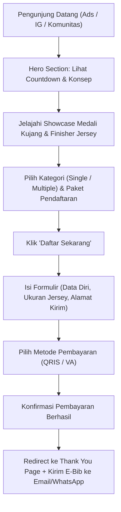

# PRODUCT REQUIREMENT DOCUMENT (PRD)
## Landing Page Event Virtual Run: "Kujang 10K" by Budayarun

* **Project Name**: Landing Page Kujang 10K Virtual Run
* **Organizer / Brand**: Budayarun
* **Document Version**: v1.0.0
* **Status**: Ready for Review / Execution
* **Target Launch**: Q1 2027 / Early Campaign Cycle
* **Target Running Period**: 30 Hari Periode Virtual Run

---

## 1. Executive Summary & Background

### 1.1 Latar Belakang
**Budayarun** adalah platform dan gerakan lari yang menggabungkan gaya hidup sehat (olahraga lari) dengan apresiasi terhadap warisan budaya Nusantara. Setelah berbagai inisiatif lari tematik, Budayarun menghadirkan **"Kujang 10K Virtual Run"**, sebuah ajang lari virtual bertema kebudayaan Sunda (Jawa Barat). 

Simbol utama acara ini adalah **Kujang**, senjata tradisional khas Sunda yang melambangkan keberanian, ketangguhan, marwah ksatria, dan keadilan. Melalui format *virtual run*, acara ini bersifat inklusif bagi seluruh pelari di seluruh Indonesia maupun mancanegara tanpa batasan geografis.

### 1.2 Tujuan Produk (Product Objectives)
1. **Konversi Pendaftaran**: Menjadi *central conversion hub* untuk konversi pengunjung menjadi peserta berbayar (target pendaftaran: 3.000 – 5.000 peserta).
2. **Edukasi & Brand Awareness**: Memperkenalkan filosofi Kujang dan identitas Budayarun sebagai inisiator *cultural sports lifestyle*.
3. **Showcase Finisher Rewards**: Menonjolkan medali 3D die-cast Kujang yang prestisius dan finisher jersey berkualitas tinggi sebagai magnet utama peserta.
4. **User Experience Mulus**: Menyediakan alur registrasi, pemilihan ukuran jersey, hingga pembayaran instan dalam waktu di bawah 3 menit.
5. **Akses Informasi Terpusat**: Memberikan panduan submission lari, validasi hasil via aplikasi lari (Strava, Garmin, NRC, Suunto), dan tracking pengiriman medali.

---

## 2. Target Audience & User Personas

| Persona | Profil & Karakteristik | Kebutuhan Utama pada Landing Page |
| :--- | :--- | :--- |
| **The Medal Collector (Rian, 29 th)** | Pelari antusias, gemar mengoleksi medali unik, aktif di Instagram & Strava. | Foto detail medali Kujang dari berbagai sudut (3D render/video), spesifikasi material, dan bobot medali. |
| **The Cultural Enthusiast (Dewi, 34 th)** | Mengapresiasi kebudayaan Sunda, pelari rekreasional akhir pekan, mengutamakan pengalaman dan makna filosofis. | Cerita filosofi Kujang, jersey etnik modern yang modis untuk daily wear, dan rute rekomendasi bersejarah. |
| **The Beginner Virtual Runner (Budi, 24 th)** | Baru memulai rutinitas lari, mencari event tanpa tekanan waktu dan fleksibel (bisa dicicil). | Panduan jelas cara ikut lari virtual, opsi cicil jarak (multiple run), tutorial sync Strava, dan FAQ. |
| **Komunitas Lari / Corporate (Komunitas 20+ pax)** | Koordinator komunitas running di Bandung/Jakarta yang mendaftarkan anggota secara kolektif. | Kemudahan pendaftaran grup, diskon bundling komunitas, dan CS support cepat via WhatsApp. |

---

## 3. Product Goals & Key Performance Indicators (KPIs)

* **Conversion Rate (CR)**: $\ge 4.5\%$ (dari total unique visitor menjadi pendaftar berbayar).
* **Page Load Time**: $< 2.0$ detik di perangkat mobile pada jaringan 4G standar (LCP $< 2.2$s, FID $< 100$ms, CLS $< 0.1$).
* **Drop-off Rate Pendaftaran**: Turun hingga $< 20\%$ pada step checkout/pembayaran.
* **Customer Support Inquiries**: $< 5\%$ pengunjung yang membutuhkan bantuan manual live chat karena informasi landing page sudah sangat transparan dan intuitif.

---

## 4. Kategori & Timeline Resmi Event

1. **Kategori Jarak**:
   * **10K Single Run**: Menyelesaikan jarak 10 kilometer dalam satu sesi lari tunggal (cocok untuk target *Personal Best* / tantangan).
   * **10K Multiple Run (Akumulasi)**: Menyelesaikan total 10 kilometer dengan akumulasi maksimal 3 - 5 sesi lari selama periode event berlangsung (inklusif untuk pemula).

2. **Jadwal & Timeline Resmi Event (Kickoff: 17 November 2026)**:
   * **Pendaftaran Early Bird (10 Hari)**: 17 – 26 November 2026 (Slot terbatas, diskon s/d 30%).
   * **Pendaftaran Reguler (20 Hari)**: 27 November – 16 Desember 2026 (Pendaftaran ditutup 16 Des 2026, 23:59 WIB).
   * **Periode Lari & Submission**: 17 November – 20 Desember 2026 (Fleksibel lari kapan saja).
   * **Masa Produksi Medali & Jersey (21 Hari)**: 17 Desember 2026 – 6 Januari 2027 (Die-cast 3D Zinc Alloy & custom sizing jersey).
   * **Quality Control & Packing (3 Hari)**: 7 – 9 Januari 2027 (Inspeksi mutu & pengemasan race pack).
   * **Pengiriman Serentak ke Seluruh Indonesia**: Mulai 10 Januari 2027 (3 hari pasca produksi rampung) secara eksklusif menggunakan ekspedisi resmi **SPX Express (Shopee Xpress)**.

3. **Metode Validasi**:
   * Sinkronisasi data aktivitas GPS dari aplikasi (Strava, Garmin Connect, Suunto, Coros, Nike Run Club, Apple Fitness, Treadmill display photo) melalui portal submission Budayarun.

---

## 5. Scope & Fitur Landing Page (Functional Requirements)

### 5.1 Modul Header & Hero Section
* **FR-1.1 Countdown Timer**: Hitung mundur dinamis menuju penutupan slot Early Bird atau penutupan pendaftaran.
* **FR-1.2 Dynamic Value Proposition**: Headline menarik *"Taklukkan Langkahmu, Warisi Semangat Ksatria Kujang"*.
* **FR-1.3 Dual Call to Action (CTA)**: Tombol utama *"Daftar Sekarang"* (scroll otomatis ke pricing tier atau modal form) & tombol sekunder *"Lihat Medali & Jersey"*.
* **FR-1.4 Quick Stats Bar**: Total peserta terdaftar (social proof live counter), slot tersisa, dan kategori jarak.

### 5.2 Modul Filosofi & Storytelling "Kujang"
* **FR-2.1 Cultural Storytelling**: Narasi singkat mengenai Kujang sebagai simbol ketajaman pikiran, ketulusan tekad, dan kehormatan tanah Parahyangan.
* **FR-2.2 Nilai Utama Budayarun**: 3 pilar: *Warisan Leluhur, Raga Sehat, Komunitas Guyub*.

### 5.3 Modul Showcase Finisher Rewards & Race Pack
* **FR-3.1 Interactive 3D / High-Res Medal Viewer**:
  * Tampilan medali Kujang die-cast antique brass finishing, detail tali medali berukir mega mendung etnik.
  * Spesifikasi medali: Berat $\pm 120\text{ gr}$, bahan Zinc Alloy, diameter $8.5\text{ cm} \times 4\text{ cm}$.
* **FR-3.2 Finisher Jersey Preview**:
  * Visual depan & belakang jersey dry-fit high-performance dengan aksen siluet Kujang.
  * Fitur Zoom & Size Chart interaktif (Lebar Dada, Panjang, rekomendasi ukuran berdasarkan TB/BB).
* **FR-3.3 Race Pack Items Breakdown**:
  * Finisher Medal Kujang 3D.
  * Dry-fit Exclusive Finisher Jersey by Budayarun.
  * Personalized E-Bib & E-Certificate (dengan nama dan waktu tempuh).

### 5.4 Modul Paket Pendaftaran & Pricing Tier
Tabel dan kartu paket yang sesuai 1:1 dengan sistem pendaftaran LariVirtual (`https://larivirtual.com/events/kujang-virtual/register`) pada periode Reguler (27 November – 16 Desember 2026):
* **Medali Only (Rp 169.000)**: Medali Zinc Alloy 3D Twin Kujang & Gedung Sate + E-Bib + E-Sertifikat + Pengiriman via SPX.
* **Jersey event + Medali (Rp 220.000)**: Jersey Event Royal Blue Pop-Art Sunda + Medali 3D Twin Kujang + E-Bib + E-Cert + Pengiriman via SPX.
* **Jersey Finisher + Medali (Rp 220.000)**: Finisher Jersey Volt Lime to Emerald + Medali 3D Twin Kujang + E-Bib + E-Cert + Pengiriman via SPX.
* **Jersey Event + Finisher + Medali (Rp 359.000)**: Paket Lengkap 2 Jerseys (Event + Finisher) + Medali 3D Twin Kujang + E-Bib + E-Cert + Pengiriman via SPX.
* **Opsi Add-on Jersey Only**:
  * **Jersey Event Only (Rp 150.000)**: Jersey Event Royal Blue Dryfit + E-Bib & E-Cert.
  * **Jersey Finisher Only (Rp 159.000)**: Finisher Jersey Volt Lime Dryfit + E-Bib & E-Cert.

### 5.5 Modul Alur 4 Langkah Mudah Ikutan (How It Works)
1. **Daftar & Pilih Paket**: Lengkapi data diri dan pilih paket race pack.
2. **Lari Dimana Saja**: Lari outdoor/indoor kapan saja dalam periode event menggunakan smartwatch / running app favorit.
3. **Submit Bukti Lari**: Unggah screenshot atau sinkronisasi URL aktivitas lari pada portal peserta.
4. **Terima Medali Kujang**: Medali dan jersey dikirimkan langsung ke alamat rumah peserta via **SPX Express**.

### 5.6 Modul Formulir Pendaftaran / Quick Checkout
* Integrasi langsung (embed modal checkout atau redirect ke Budayarun registration engine):
  * Data Diri: Nama lengkap, email, nomor WhatsApp aktif, gender, tanggal lahir.
  * Pilihan Kategori: 10K Single Run / 10K Multiple Run.
  * Pilihan Ukuran Jersey: XS, S, M, L, XL, XXL, 3XL (+ custom name printing opsional).
  * Alamat Pengiriman: Integrasi autocomplete kecamatan/kota & hitung ongkir otomatis dengan ekspedisi resmi tunggal (**SPX Express**).
  * Payment Gateway: QRIS (GoPay, OVO, ShopeePay, DANA), Virtual Account (BCA, Mandiri, BRI, BNI), Kartu Kredit/Debit.

### 5.7 Modul FAQ (Frequently Asked Questions) & CS Live Support
* Accordion menu kategori: Aturan Lari, Aplikasi Tracking yang didukung, Pengiriman Paket, Pembatalan/Refund.
* Floating WhatsApp CTA untuk bantuan personal bagi peserta yang mengalami kendala teknis.

---

## 6. Non-Functional Requirements (NFR)

1. **Performance & Speed**:
   * Next-gen image format (WebP / AVIF), lazy-loading untuk foto produk, optimasi font display swap.
   * CDN caching untuk aset statis.
2. **Responsiveness & Cross-browser Compatibility**:
   * Mobile-first responsive layout (360px – 1440px+).
   * Kompatibel dengan Safari iOS, Chrome Mobile & Desktop, Firefox, Edge, dan in-app browsers (Instagram browser, TikTok browser).
3. **Keamanan & Kepatuhan Privasi**:
   * Enkripsi SSL/TLS 256-bit.
   * Kepatuhan privasi data pribadi peserta (UU PDP Indonesia: nomor HP dan alamat terlindungi).
4. **SEO & Social Sharing (Open Graph)**:
   * Meta title: *"Kujang 10K Virtual Run by Budayarun - Taklukkan Langkahmu, Rayakan Budaya"*.
   * Rich Open Graph preview (thumbnail medali Kujang yang memikat saat dibagikan ke WhatsApp dan Instagram Stories).

---

## 7. User Flow (Alur Pengguna)

